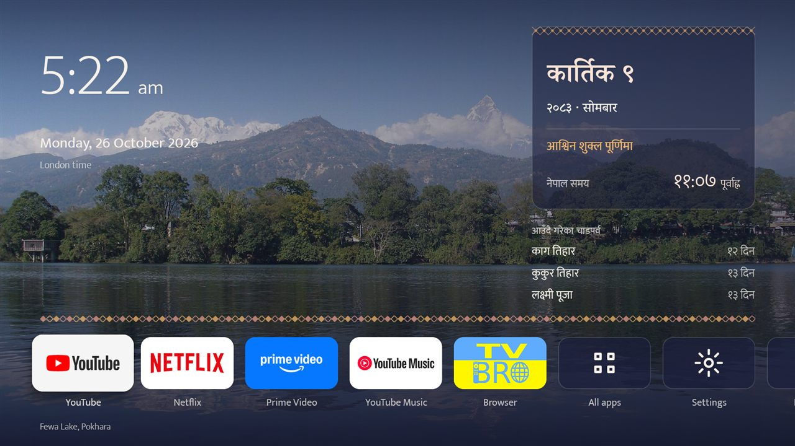
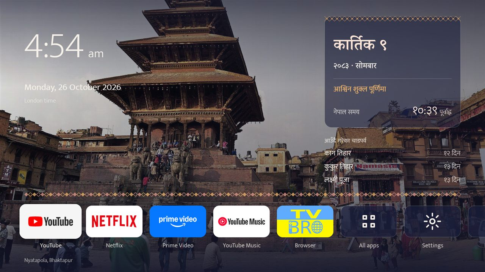
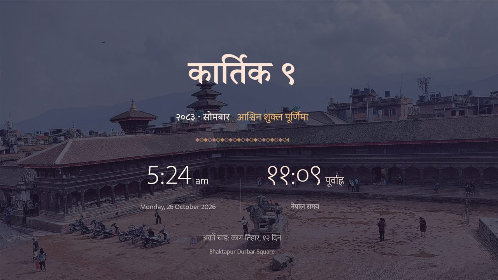

# Himalayan Dawn Android TV Launcher

An ad-free home screen (launcher) for Android TV with the Nepali calendar built in. It shows:
- the Bikram Sambat date in Devanagari
- today's tithi
- upcoming festivals
- a Nepal clock beside your local clock

The background is a set of photos of Nepal that change slowly.

> **Use at your own risk.** Installing Himalayan Dawn means turning on developer options and switching off your TV's built-in home screen. This may affect your warranty or the support your TV maker offers. Read the [Disclaimer](#disclaimer) before you start.



| | |
|---|---|
|  |  |
| Home screen | Screensaver |

## Features

- **Two clocks:** your local time and Nepal time (नेपाल समय), with the AD date
- **Bikram Sambat date** in Devanagari, for example कार्तिक ९, २०८३ · सोमबार
- **Today's tithi**, for example आश्विन शुक्ल पूर्णिमा
- **Upcoming festivals** with a countdown: Dashain, Tihar, Chhath, Teej, Janai Purnima, Shivaratri, Holi, Buddha Jayanti, Tamu Lhosar, national days and others
- **Eleven photos of Nepal** that cross-fade every minute: Fewa Lake, Annapurna, Machhapuchhre, Bhaktapur, Swayambhunath, Patan, Rara Lake, Everest and more
- **The same calendar as a screensaver**
- **Optional "Who's watching?" screen** and a Kids mode protected by a PIN
- **Closes leftover background apps** when the TV starts, and shows a notice when storage is low
- **A Browser tile** for [TV Bro](https://github.com/truefedex/tv-bro), a browser designed for TV remotes
- **No ads, no tracking, no internet access** (see [Privacy](#privacy))

## Compatible TVs

| Works | Does not work |
|---|---|
| Android TV and Google TV, Android 9 or later: TCL, FFalcon, Sony, Philips, Hisense (Android models), Xiaomi, Nvidia Shield, Chromecast with Google TV, Mi Box | Samsung (Tizen), LG (webOS), Roku, Apple TV, Amazon Fire TV |

## Install

Installation takes about 10 minutes. You need a Windows, Mac or Linux computer on the same Wi-Fi network as the TV.

Before you start, read the [Disclaimer](#disclaimer). If your TV is still under warranty, check with the manufacturer first.

### 1. Prepare the TV

1. **Turn on developer options.** Open **Settings › Device Preferences › About** and press OK on **Android TV OS build** (on some TVs just **Build**) seven times, until you see "You are now a developer".
2. **Turn on debugging.** Open **Settings › Device Preferences › Developer options** and turn on **USB debugging**. If **Network debugging** is listed, turn that on too.
3. **Note the TV's IP address.** It's shown in **Settings › Network & Internet** when you select your Wi-Fi network (for example `192.168.1.50`).

### 2. Prepare the computer

1. **Download Android Platform Tools** for your system from [developer.android.com/tools/releases/platform-tools](https://developer.android.com/tools/releases/platform-tools) and unzip it.
2. **Download from the [latest release](https://github.com/theganeshlife/himalayan-dawn/releases/latest)** into that same `platform-tools` folder:
   - `HimalayanDawnTV.apk`
   - `setup-tv.ps1` (Windows) or `setup-tv.sh` (Mac/Linux)

### 3. Run the setup

Open a terminal in the `platform-tools` folder, then run the command for your system, using your TV's IP address.

- **Windows:** right-click inside the folder and choose **Open in Terminal**, then:
  ```powershell
  $env:Path = "$PWD;$env:Path"
  powershell -ExecutionPolicy Bypass -File .\setup-tv.ps1 -Tv 192.168.1.50 -Apk .\HimalayanDawnTV.apk
  ```
- **Mac / Linux:**
  ```bash
  export PATH="$PWD:$PATH"
  bash setup-tv.sh 192.168.1.50 HimalayanDawnTV.apk
  ```

When the TV asks **"Allow USB debugging?"**, tick **Always allow from this computer** and select **OK**. Then press **Home** on the remote.

### 4. Choose your settings

On the home screen, open the **Launcher** tile:
- **Home city for the clock:** choose your city if the clock shows "Local time".
- **Set a PIN:** needed if you want Kids mode to stay locked.

To choose which apps appear on the home screen, open **All apps** and press and hold OK on an app.

### Undo

To restore the TV's original home screen and screensaver, run the setup script again with `-Undo` (Windows) or `--undo` (Mac/Linux):

```powershell
powershell -ExecutionPolicy Bypass -File .\setup-tv.ps1 -Tv 192.168.1.50 -Undo
```

### What the setup changes

The script:
1. installs the app
2. switches off (does not delete) the TV's stock launcher and its Ambient Mode screensaver
3. sets Himalayan Dawn as the screensaver

Android TV gives its stock launcher priority over any installed app, so the stock launcher has to be switched off for Himalayan Dawn to become the home screen.

### Newer Google TV devices

Some newer devices show **Wireless debugging** instead of Network debugging. On those:
1. Select **Pair device with pairing code** on the TV.
2. Run `adb pair <address shown on TV>` and enter the code shown.
3. Run the setup with the connect address shown on the TV, for example `-Tv 192.168.1.50:37123`.

## Optional scripts

Both scripts are in the `scripts/` folder of this repository.

- **`clean-tv.ps1` / `clean-tv.sh`:** clears the cache of every app and closes background apps. Apps, sign-ins and settings are not affected. Running it once a month is enough.
  ```powershell
  powershell -ExecutionPolicy Bypass -File .\clean-tv.ps1 -Tv 192.168.1.50
  ```
- **`tcl-tidy.ps1` (TCL and FFalcon TVs only):** switches off TCL's advertising, promotion and analytics apps. Run it again with `-Undo` to switch them back on. Check the list in the script before using it on another brand.

## How the calendar works

- **Dates:** Bikram Sambat dates use the published month-length table for BS 2000–2090.
- **Tithi:** calculated on the TV from the positions of the sun and moon at sunrise in Kathmandu, so it matches Nepal's calendar wherever the TV is.
- **Month names:** lunar months follow Nepali practice, where the dark fortnight takes the name of the following month.
- **Festival dates:** each festival follows its traditional rule. Most use the tithi at sunrise; Laxmi Puja uses the evening (pradosh); Kojagrat, Shivaratri, Janmashtami, Fulpati and Maha Ashtami use midnight.
- **Testing:** automated tests compare the 2083 Dashain, Tihar and Chhath dates with Hamro Patro, and all of them match.
- **Limitations:**
  - When a tithi changes within a few minutes of sunrise, a date can occasionally differ by one day from a printed calendar.
  - Dates are available up to BS 2090 (2034 AD).

## Privacy

Himalayan Dawn does not collect or send any data.

- **No internet access.** The app does not request internet permission, so it cannot connect to any server. All calendar data and photos are included in the app.
- **Two permissions only:** starting when the TV boots, and closing idle background apps.
- **No analytics, advertising, accounts, crash reporting or third-party libraries.**
- **Settings stay on the TV**, in the app's private storage: pinned apps, Kids mode apps, scene timing and home city. The PIN is stored as a one-way hash, not the PIN itself.
- **Not backed up anywhere.** Android backup is turned off for the app. Uninstalling it removes everything it stored.

## Security

While debugging is turned on, any device the TV has allowed can control the TV over the network. The TV always asks before allowing a new device; only allow devices you recognise.

Himalayan Dawn does not need debugging after installation. You can turn **USB debugging** and **Network debugging** off once setup is finished, and turn them on again only when you run a script.

## Building from source

Requirements: JDK 17 and the Android SDK (platform 34, build-tools 34.0.0).

```bash
git clone https://github.com/theganeshlife/himalayan-dawn.git
cd himalayan-dawn
./gradlew :tv:testDebugUnitTest      # calendar and festival tests
./gradlew :tv:assembleRelease        # APK in tv/build/outputs/apk/release/
```

**Signing:** release builds are signed with the Android debug key unless you provide your own. To use your own key, create `signing/himalayandawn.jks` with `keytool`, then `signing/keystore.properties` containing:

```
storeFile=himalayandawn.jks
storePassword=…
keyAlias=…
keyPassword=…
```

The `signing/` folder is excluded from git.

| Path | Contents |
|---|---|
| `tv/` | Launcher, screensaver, welcome and PIN screens |
| `tv/src/main/java/app/himalayandawn/tv/calendar/` | Bikram Sambat conversion, sun and moon positions, tithi and festival rules |
| `scripts/` | Setup, undo, clean-up and TCL scripts |

**Optional adb commands:**
- Show a particular scene: `adb shell am start -n app.himalayandawn.tv/.HomeActivity --es scene fewa`. Scene IDs are listed in `tv/src/main/assets/scenes/scenes.json`.
- Turn Kids mode on or off: `adb shell am broadcast -n app.himalayandawn.tv/.RemoteReceiver -a app.himalayandawn.tv.KIDS_ON` (or `KIDS_OFF`).

## Disclaimer

Himalayan Dawn is a personal, non-commercial project, provided **as is, without any warranty**. You use it **entirely at your own risk**.

- **Warranty and support:** turning on developer options, enabling debugging and switching off the TV's built-in launcher are changes the manufacturer did not intend. They may void or affect your warranty, and may affect support from your TV maker, retailer or service provider. If your TV is under warranty, check with them first.
- **Testing:** the app was developed and tested on a single Android 11 TV that was out of warranty. Other models, brands and Android versions may behave differently.
- **Firmware updates:** a system update from your TV maker may re-enable the stock launcher, change settings or stop the app from working.
- **Optional scripts:** `tcl-tidy.ps1` switches off manufacturer apps. Switching off the wrong app on a different model could break features such as voice search, casting or TV inputs.
- **Before you start:**
  - Keep the [Undo](#undo) command handy.
  - Don't switch off apps you don't recognise.
  - If anything goes wrong, a factory reset from the TV's settings restores it to its original state (this erases your apps and sign-ins).
- **Liability:** the author and contributors accept no responsibility for any damage, data loss, loss of warranty or other problems resulting from using this software or following these instructions.
- **Calendar dates:** tithi and festival dates are calculated and may occasionally differ from official calendars. For religious or important dates, check a trusted patro.

## Reporting problems

Please [open an issue](https://github.com/theganeshlife/himalayan-dawn/issues/new/choose) and include your TV brand and model, the Android version (**Settings › Device Preferences › About**), what you expected, what happened, and a photo of the screen if possible.

Confirmed issues are investigated and fixed with the help of [Claude](https://www.anthropic.com/claude). Every fix is reviewed before it is merged and released.

## Contributors

- **[theganeshlife](https://github.com/theganeshlife)**: idea, design direction, testing on a real TV, and maintenance
- **[Claude](https://www.anthropic.com/claude)** (Anthropic): co-developer; wrote much of the code, calendar calculations, scripts and documentation using Claude Code

## Licence and credits

The source code is released under the MIT licence (see [LICENSE](LICENSE)).

Bundled photos (Wikimedia Commons, CC BY and CC BY-SA), fonts (Mukta and Noto Serif Devanagari, SIL Open Font License) and the Bikram Sambat month table (nepali-date-converter, MIT) are used under their own licences. [THIRD_PARTY_NOTICES.md](THIRD_PARTY_NOTICES.md) lists every photographer and source. The app also shows them under **Launcher › Photo credits and licences**.

This project is not affiliated with Google, TCL or any TV manufacturer.
